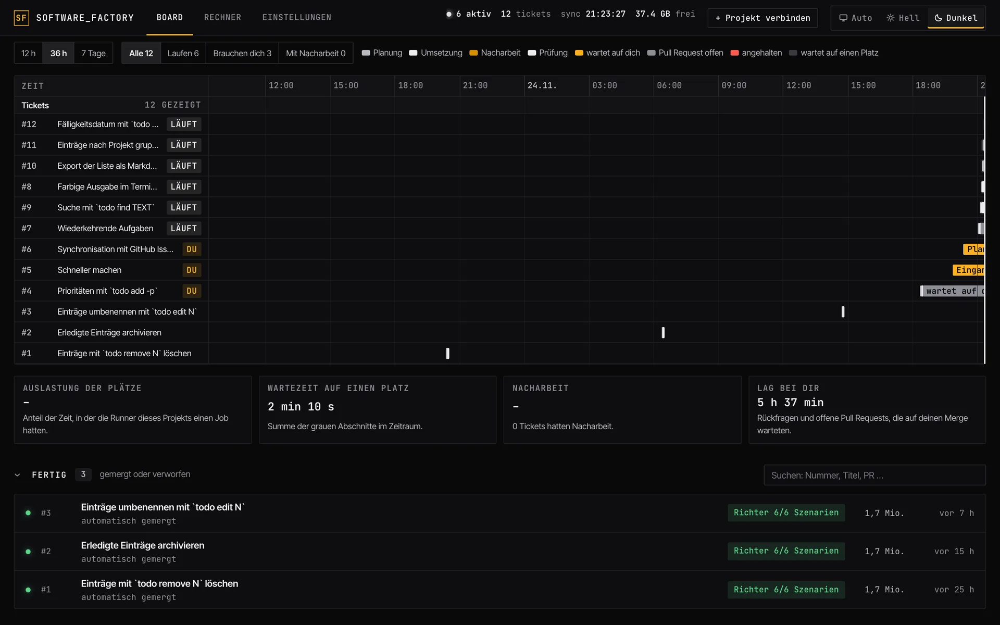

<h1 align="center">
  <picture>
    <source media="(prefers-color-scheme: dark)" srcset="docs/assets/logo-dark.svg">
    
  </picture>
</h1>

<p align="center">
  <a href="https://github.com/HanSur94/software-factory/actions/workflows/selftest.yml"></a>
  <a href="LICENSE"></a>
  
</p>

A GitHub issue with the label `factory:go` becomes a reviewed pull request here: agents plan, write and review the code, and a separate judge tests the result against scenarios the implementer never saw. In dark mode the pull request is then merged without a human; otherwise you merge by hand.

<p align="center">
  <a href="https://hansur94.github.io/software-factory/?lang=en"></a>
</p>

<p align="center"><b><a href="https://hansur94.github.io/software-factory/?lang=en">Project page</a></b> · <a href="#quick-start">Quick start</a> · <a href="#board">Board</a> · <a href="CONTRIBUTING.md">Contributing</a> · <a href="README.de.md">Deutsch</a></p>

> **Language:** The board, the settings page and the comments the factory writes on issues are in German. The station prompts are in English. This README names the German labels where you need them to find a button. `CONTRIBUTING.md` and `SECURITY.md` are in German too.

## One real ticket

Not a staged example: this is a run of the factory in a test project, a small to-do list for the command line. The issue asked for a command `todo remove N`. Times and costs come from the files of that run.

| Station | Model | Time | Cost | Result |
|---|---|--:|--:|---|
| Intake | Haiku 5.5 | 15 s | $0.004 | fixed mandate, size S, 5 acceptance criteria |
| Planner | Fable 5.2 | 63 s | $0.175 | 1 task, 9 acceptance criteria, 5 named risks |
| Plan check | Opus 5.5 | 19 s | $0.165 | passed, 0 blocking points |
| Implementer | Sonnet 5.5 | 27 s | $0.105 | `todo/cli.py` and `tests/test_cli.py` |
| Checks | – | < 1 s | – | project tests green |
| Reviewer | Opus 5.5 | 39 s | $0.232 | approved, 0 blocking, 5 remarks |
| Judge | Opus 5.5 | 53 s | $0.294 | 6 of 6 hidden scenarios passed |
| **Total** | | **3 min 37 s** | **$0.98** | from label to verdict |

That ticket is small. In eight days of real use in two private projects (16 to 23 November 2026), counted from the state files:

- **196** tickets, 53 of them split into parts; **93** became a pull request, 22 of those are merged
- **76 %** of the pull requests needed at least one rework round (71 of 93)
- **37 min** agent working time per ticket (median); a quarter took more than 81 min
- **4.9 million** tokens per ticket (median, cache reads included)
- **62 of 92** tickets passed every scenario of the judge in their last verdict

What does not work yet is listed under [Status](#status).

## Quick start

You need:

- Python 3.12 and `pip install -r requirements.txt`
- the [GitHub CLI](https://cli.github.com/) `gh`, signed in with `gh auth login`
- [Claude Code](https://claude.com/claude-code) and a Claude subscription; on GitHub as the secret `CLAUDE_CODE_OAUTH_TOKEN` from `claude setup-token`

```bash
git clone https://github.com/HanSur94/software-factory.git
cd software-factory
pip install -r requirements.txt
python3 -m factory board          # board and settings at http://127.0.0.1:8787
```

On the board choose "+ Projekt verbinden" (connect project, see [Connecting a project](#connecting-a-project)), then set the label `factory:go` on an issue. It also works without GitHub: [Running locally](#running-locally).

## How a ticket flows

| Station | Who | Reads | Writes |
|---|---|---|---|
| Intake | Haiku 5.5 | the issue | `ticket.json` with a fixed mandate, or a question in the issue |
| Planner | Fable 5.2 | ticket, repo | `plan.md`: tasks with acceptance criteria |
| Plan check | Opus 5.5 | ticket, plan | `plan-review.json` |
| Implementer | Sonnet 5.5 | one task | code and tests; independent tasks at the same time, each in its own folder |
| Checks | the project's commands | the branch | the result; on failure Haiku 5.5 sums up the logs |
| Reviewer | Opus 5.5 | diff, ticket, plan | `review.md` |
| Judge | Opus 5.5 | the built state, the scenario repo | `verdict.json`: score and failure, never the scenario text |
| Delivery | script | the verdict | the pull request and, in dark mode, the merge; or the next round |

Every station starts with fresh context and sees only the files of the stations before it. A plain script (`factory/pipeline.py`) is in charge, not an agent: it runs the stations in a fixed order, counts rounds and budget, and stops at a limit.

### Parallel workers

Tasks of a plan that do not depend on each other and touch different files run at the same time. Each worker gets its own folder: a git worktree `wt-<ticket>-<task>` on its own branch, starting from the state of the ticket branch. The workers do not see each other.

The control script decides what may run together, not an agent. It reads `depends_on` and `files` of the tasks in the plan:

- A task starts only when everything it depends on is done.
- Two tasks that name the same file or folder do not run in the same wave.
- A task without `files` runs alone.
- Never more than `pipeline.parallel_tasks` workers (default 3) run at once; with 1 everything runs one after another.

When the workers of a wave are done, the script puts their commits onto the ticket branch one by one and deletes the folders. If a commit does not fit onto the others, it is discarded and its task runs again in the ticket's folder, where it sees what the others built. Checks, review and judge test the merged state as before. The remaining budget of the ticket is split among the workers of a wave. If one worker fails, the ticket stops; what the others finished is kept.

Parallel workers shorten the lead time. They do not save cost, and they use up the subscription quota faster.

On GitHub these are four jobs with different permissions (`.github/workflows/run-ticket.yml`):

- `route` reads the project profile and picks the runners
- `work` runs from intake to review and pushes the ticket branch
- `judge` is the only job that sees the scenario repo; only `verdict.json` leaves it
- `deliver` opens the pull request or starts the next round

## Layout

```
factory.yaml          everything you can choose: models, order, thresholds, limits, runners
contracts/            schemas of the contract files, each with a version number
stations/             one prompt per station
factory/              the control script
  pipeline.py           order, loops, budget, parking
  stations.py           run a station, check its contract file
  agent.py              the running agent: environment, time limit, transcript, result
  harness/              one adapter per agent CLI (today claude.py for Claude Code)
  hosts.py              ticket system and code host: GitHub or local files
  state.py              state: a branch in the product repo or a local folder
  judge.py, deliver.py  judge and delivery
  report.py             key figures from the event log
  board.py, board.html  the Kanban board in the browser
  theme.css, theme.js   shared look of board and settings page, light/dark/auto
action.yml            brings this repo's code into the jobs of the product repos
templates/product/    what a product repo needs: workflow, profile, issue template
plugin/               interactive station: the skill factory-handoff
tests/                contract tests and the whole flow as a dry run
```

Subsystems talk to each other only through contract files. You swap a part by replacing its file and running the tests.

## Configuration

Three layers decide how the factory works; each overrides the one before:

1. `factory.yaml`: the documented defaults
2. `settings.yaml`: what you changed for all projects, written by the settings page
3. the `overrides` section in a project's profile: what differs only there

The result is checked against `contracts/config.schema.json` before every run. A wrong value stops the run with a message that names the key.

### Settings page

```bash
python3 -m factory board
```

Then open `http://127.0.0.1:8787/settings` (or click "Einstellungen" at the top right of the board). At the top you choose what the values apply to:

- **All projects ("Alle Projekte"):** Saving writes `settings.yaml`, and only what differs from `factory.yaml`. Local runs use the values at once. Runs on GitHub read the factory from `main`, so "Speichern und veröffentlichen" (save and publish) commits and pushes the file as well. What concerns only your machine, that is the board's projects (`board.repos`, `board.local`) and the machine monitoring (`machine`), goes into `settings.local.yaml`. Git ignores that file so that your project list is not published with the factory.
- **One project:** Saving writes the `overrides` section in `.factory/profile.yaml` as a commit on the project's default branch. Empty fields take the value for all projects. The page also shows the project's checks there and whether the two credentials (secrets) are set; you have to enter them yourself.

You can set the flow (advisory, blocking or off per station, number of rounds), delivery including the rules for automatic merging, thresholds and budgets, per station the model, effort, budget, time limit, fallback model and skills, the runners, the skill packs and the board. The switch **Dark-Modus** sets the four values at once. For everything without a field of its own, "Erweitert" (advanced) offers `settings.yaml` as text.

The page is the only part of the board that writes. It accepts only requests that come from itself on this machine.

### By hand

The same values can be changed in the files. The most common moves:

- **Change the model of a role:** the line `model` under `roles.<role>`.
- **Arm a station:** `pipeline.modes`. `advisory` only reports, `gate` blocks and sends back, `off` skips. At the start plan check, review and judge are advisory; `python3 -m factory report` shows from when a station agrees with your verdict often enough.
- **Swap runners:** `runtime.capabilities` says where a capability runs. A project names only the capability in its profile (`runtime: { work: unity }`).
- **Differ for one project:** the `overrides` section in the project's profile.
- **Choose the agent CLI:** `agent.harness` for all stations, `roles.<role>.harness` for a single one (also on the settings page, per station). Today there is only `claude` (Claude Code).

Budget, satisfaction threshold and the rule for arming are example values.

### Harnesses

A station needs only this from the agent: run a prompt in a folder, report result and cost. What a CLI calls and prints for that is written in an adapter under `factory/harness/`. An adapter builds the call (`argv`), reads the output line by line into neutral events (`text`, `tool`, `result`) and says in `capabilities` what the CLI can do itself: budget limit, fallback model, effort, command allowlists, plugins, skill tool, cost reporting. Time limit, cleaned environment, session log and contracts stay in `agent.py` and apply to every adapter alike.

On GitHub every job installs the CLIs of the harnesses its stations run in; the judge job only the judge's. `agent.versions.<harness>` sets the version, for the default harness also `agent.version`, otherwise `latest`.

A harness without command allowlists runs only on a sandbox runner (`FACTORY_SANDBOXED=1`); otherwise the station stops with a message. Which secrets a project needs follows from the harnesses its stations run in.

A new harness is one module next to `claude.py` and one line in `factory/harness/__init__.py`.

## Dark mode

A project goes dark when its profile turns the checking stations into gates and switches on auto-merge:

```yaml
overrides:
  pipeline:
    modes: { plan_check: gate, review: gate, judge: gate }
  delivery:
    auto_merge: true
```

Merging then happens without a human, but only if all rules are met (`delivery.auto_merge_rules` in `factory.yaml`):

- the checks are green, the review approved, the judge passed
- the judge had at least 3 scenarios
- the change is at most 200 lines
- the ticket is not marked as sensitive
- the change touched no protected paths
- the branch contains the current base branch; if the base has moved in the meantime, it is brought in and the checks run again

If a rule is not met, the pull request stays open and the comment on the issue names the reason. New projects start without auto-merge.

## More autonomy

Three switches let the factory do more on its own. Together they look like this in the profile:

```yaml
overrides:
  pipeline:
    questions: assume
  limits:
    max_parallel_tickets: 8
    daily_budget_usd: 40
  delivery:
    auto_merge: true
    auto_merge_rules: { require_judge: false, allow_assumptions: true }
```

- **Assumptions instead of questions** (`pipeline.questions: assume`): Intake and planner settle open points themselves, take the reading that is easiest to change later, and write every assumption into a comment on the issue and into the pull request ("Annahmen, bitte prüfen": assumptions, please check). The ticket stops only for what only you can provide: a program or device outside the repo (such as an installed game), an access, a secret, or a decision where a wrong assumption would be expensive. Big plans no longer wait for `/approve`.
- **Merging without judge scenarios** (`auto_merge_rules.require_judge: false`): If the judge has nothing to test, the factory merges as soon as all checks on the pull request are green, the review approved and the other rules are met. A judge that explicitly fails still holds the merge. Tickets with assumptions stay with a human as long as `allow_assumptions` is not set.
- **Orchestrator** (`python3 -m factory orchestrate`, on a schedule in the calling workflow): looks at all tickets of the project and
  - restarts tickets whose run broke off (no run and no event for `orchestrator.stale_minutes`) or that got stuck on a fault of the machinery, at most `orchestrator.max_auto_restarts` times; stops caused by the work itself (budget, rework rounds, judge) stay with you;
  - fetches CI results that never arrived (red: rework, green: merge);
  - brings delivered pull requests that GitHub reports as a merge conflict with the base back up to date by itself: the next run brings in the base, the implementer resolves the conflict (phase `rework_base`), then checks, review and judge test again. At most once per commit of the base, only with a free slot and daily budget left; a conflict that stays waits for you;
  - gives free slots to waiting tickets.

  `limits.max_parallel_tickets` and `limits.daily_budget_usd` (spending of all tickets of one UTC day) limit slots and money. A ticket without a slot waits with the label `factory:queued`; every run that ends starts the oldest waiting one itself, the schedule is only the net underneath.

## Connecting a project

The easiest way is the web interface: "+ Projekt verbinden" at the top right of the board (or `http://127.0.0.1:8787/settings#verbinden`).

1. Enter the repo (the name as `owner/name` or the GitHub address; your own repos are suggested) and click "Prüfen" (check). The page shows what is already there and what is missing, and suggests setup and checks from the files of the repo.
2. Look at or change the target branch, the runner and the commands of the checks, then click "Verbinden" (connect).
3. The page creates the labels, allows Actions to open pull requests, opens a pull request with profile, workflow and ticket template, and adds the project to the board. If the project does not work on the default branch, a second pull request follows that only brings the workflow onto the default branch.
4. What is left for you: merge the pull requests and enter the access to Claude as a secret. The page shows the command; it does not touch the token.

The page never writes directly to a branch that is being worked on. A connected project always shows the same state under its name ("Stand neu prüfen": check again), and "aus dem Board nehmen" (remove from the board) takes it out of the display again.

The same by hand:

1. `setup/attach-project.sh OWNER/REPO` creates the labels and allows Actions to open pull requests.
2. Copy the contents of `templates/product/` into the repo and adapt `.factory/profile.yaml` (checks, scenario repo).
3. Set a model access as a secret, one of the two:
   ```bash
   gh secret set ANTHROPIC_API_KEY --repo OWNER/REPO
   ```
   ```bash
   gh secret set CLAUDE_CODE_OAUTH_TOKEN --repo OWNER/REPO
   ```
   The second way uses your Claude subscription; `claude setup-token` creates the token.
4. For the judge, create a private scenario repo and store its deploy key (read-only) as the secret `SCENARIOS_DEPLOY_KEY` in the product repo.

For projects that do not develop on the default branch or need a runner of their own:

- **Target branch:** `base: develop` in the calling workflow (both places). Tickets then start from that branch, pull requests target it, and the profile is read from there. The calling workflow itself must be on the default branch, because GitHub evaluates issue events only there.
- **Required checks:** When the factory opens a pull request with the job token, GitHub often holds that pull request's workflows back for approval (`action_required`). Only those runs report to the pull request; as long as they wait, it stays blocked, even if the same checks are green when started another way. The factory therefore approves such runs itself after opening. If GitHub holds nothing back, this applies: a pull request of the factory starts no workflows of the project. If branch protection requires checks, the profile names them under `overrides.delivery.trigger_workflows`; the factory then starts them itself on the ticket branch. The workflows need the trigger `workflow_dispatch` for that.
- **CI as a gate without agents waiting:** If the CI needs a machine that exists only once (a Mac with a Unity licence), the work job stays on GitHub's runners (`runtime: { work: linux }`), and only the checks that do not need that machine run in the ticket. The heavy suite runs as CI on the pull request and waits for its runner there. Its result comes back through a last job in the CI workflow that calls `report-ci.yml` (example at the top of that file): the factory starts the CI with the job token, and for such runs GitHub starts no `workflow_run`; `workflow_dispatch` is the one way back. For runs a human triggers, the calling workflow also listens to these workflows with `workflow_run` (their `name:`, only on `factory/**` branches). If the CI is red, the ticket goes back to rework with the log of the failed steps (`rework_ci`) and then runs up to the pull request again; after `pipeline.max_ci_rounds` red rounds it stops. The settings page enters the trigger when connecting if required checks are given.
- **Slowly built folders:** `warm_dirs: [Library]` in the profile names folders that git ignores and that the project's tools rebuild only slowly (Unity's `Library/`). Every ticket folder and every parallel worker starts with a copy from the runner's checkout, on APFS as a clone without extra space. After green checks the runner takes over the newer state so that the next ticket starts warm.
- **Own runner:** `runtime: { work: unity }` in the profile sends the work job to the runner of that capability. The small control jobs (route, deliver, CI report, orchestrator, outcome) run on GitHub's runners unless the calling workflow gives every `uses:` job `runner: '["factory-mac"]'`; then the whole factory runs on your own machines. On your own runners the checkout does not clear ignored folders such as Unity's `Library/`. There the agent runs without a sandbox and may only start the programs from `agent_commands`.

After that: write an issue from the template and set the label `factory:go`. The label counts only if the owner of the repo sets it.

## Operating

| You want to | How |
|---|---|
| start a ticket | label `factory:go` on the issue |
| answer a question | reply in the issue; the ticket carries on |
| approve a big plan | reply with `/approve`, or with a change request |
| restart a stopped ticket | "Neu starten" (restart) on the board, or set `factory:go` again; it carries on where it stopped, with fresh budget. A comment from you before that goes to the implementer as a hint |
| let a ticket whose run broke off carry on | "Erneut anstoßen" (kick again) in the ticket on the board: starts the workflow for the issue again, the ticket carries on in its phase. A run that is still working is not doubled; the new one waits behind it |
| stop everything in a project | "Projekt anhalten" (stop project) on the board: disables the factory workflow and cancels its runs; "Fortsetzen" (resume) turns it back on |
| test the plumbing without tokens | Actions → factory → Run workflow, tick "Trockenlauf" (dry run) |

The state of a ticket lives in the branch `factory-state` of the product repo under `tickets/<number>/`: all contract files, `status.json` and `events.jsonl`.

## Board

A small Kanban board shows all tickets by their state: intake, planning, implementation, review, waiting for you, stopped, pull request, done.

```bash
python3 -m factory board
```

<p align="center"></p>

<table>
  <tr>
    <td width="50%"><br><sub><b>Signal box ("Stellwerk"):</b> where tickets sit and how they flow</sub></td>
    <td width="50%"><br><sub><b>Ticket:</b> every step with model and duration</sub></td>
  </tr>
  <tr>
    <td width="50%"><br><sub><b>Timetable ("Fahrplan"):</b> where the time went</sub></td>
    <td width="50%"><br><sub><b>Line ("Linie"):</b> the belt seen from the side</sub></td>
  </tr>
</table>

The captures show the board with a sample project.

Then open `http://127.0.0.1:8787`. Every project has its own board at `/p/OWNER/REPO` (local runs at `/p/local/N`): at the top what needs you, below it the production line with one lane per station, at the end the finished tickets. The start page shows all projects as tiles with open points, running work and cost; if only one project is connected, it opens that project's board directly. You switch between projects in the bar at the top. The board only reads: the branch `factory-state` of the repos under `board.repos` in `settings.local.yaml` (through `gh`) and the local runs under `board.local`. It refreshes every 8 seconds; a ticket that is being worked on has a highlighted edge.

Stopped tickets have the button **Neu starten** on their card, tickets in progress have the button **Erneut anstoßen** in the opened flow. Both start the project's workflow `factory.yml` for that issue, with your `gh` access; like the settings page, the board accepts such requests only from itself on this machine.

A click on a card opens the flow of the ticket:

- **Stations** in order: which is done, which is running, with duration and cost per station and per run
- **Skills:** which were offered to a station and which the agent really called
- **Tools:** how often which tool ran (Bash, Read, Edit, …)
- **Place:** where the station ran, for example "GitHub runner, fresh VM, no Docker"
- **Activity:** every tool call of the agents with its time, refreshed every few seconds during the run. The judge is missing there on purpose, because what it does gives the scenarios away.
- **Tokens and context window:** per run the exact tokens (input, output, read from cache, written to cache) and how full the context window was at most
- below that the mandate, the plan, the findings of the review, the failures the judge reported and the history of events

A click on a **station** in the flow opens its sessions next to it: the order to the station, what the agent said, every tool call with input and result, the answer at the end and the files the station wrote. Credentials are removed before writing. The judge's session stays in its job.

At the top of the board is the state of your **Claude subscription**: what percentage of the quota is used and when it resets. The board reads it with the login of the Claude CLI on this machine; it applies to the whole subscription, not only to the factory. Per ticket the board shows by how many percentage points the value rose during the ticket.

Below the board is a table of all tickets: duration and cost per station, working time, lead time, total cost, tokens, subscription use and skills used.

For this the factory reads every agent run line by line and publishes its state before every station and about every 15 seconds while it runs.

## Running locally

The same flow without GitHub, with the Claude login of this machine:

```bash
python3 -m factory local --repo ../my-project --issue 1 --issue-file ticket.md --scenarios ../my-project-scenarios --budget 5
```

The issue is a Markdown file (the first line is the title). Work happens in a separate worktree under `~/.cache/software-factory/<project>/`; the working state in the project folder stays untouched. Locally there is no sandbox: the implementer may only start the programs the profile names under `agent_commands`.

Tests of the factory itself, without model calls:

```bash
python3 -m pytest -q
```

## Security

- Agents and checks get a cleaned environment without a GitHub token. Only the control script does git operations over the network.
- Changes to `.github/` and `.factory/` are discarded before every commit. The profile is always read from the base branch.
- Stations that should only read cannot change the working state: what they change is reset.
- The judge gives out only the score and the failure. A failure that contains text from a scenario is held back.
- Every ticket has a budget; when it is used up, the ticket stops.
- Docker is not used. On GitHub every job runs in a fresh virtual machine that is thrown away afterwards; locally the factory runs without a sandbox in a separate worktree.

To report a vulnerability, see [SECURITY.md](SECURITY.md).

## Status

Unattended runs with a holdout judge and dark mode with auto-merge are implemented. Dark mode is switched on per project and runs in a test project.

Still open:

- Parallel workers of a ticket run on the same runner in the same job, not on several machines. Several tickets run side by side, each in its own run.
- The runner is chosen per job (work, judge), not per station.
- The plan check uses its own prompt in the pattern of fresh reviewers. The skill `egm-review-loop` is prepared (`roles.plan_check.entry`) but not yet tried unattended.
- No merge queue and no rollback. Instead of the queue, delivery brings in the base branch before the merge and checks again; the judge does not run a second time after that.
- An automatic merge by the job token triggers no further workflows and is not counted as a human verdict.
- The judge plays scenarios through the command line. For games (measurements, sliced screenshots) there is no implementation yet.
- Pull requests opened by the job token trigger no other workflows. A project with required checks on pull requests needs its own token for that.
- The board, the settings page and the factory's comments on issues are in German only.

## License

MIT, see [LICENSE](LICENSE). Free software: using, changing and passing it on is explicitly allowed.
