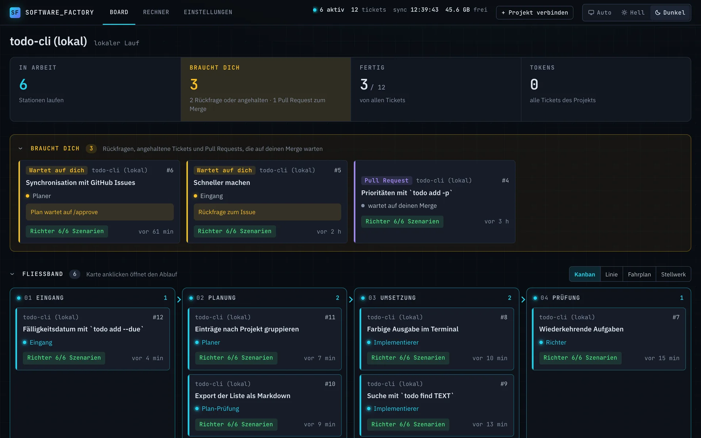
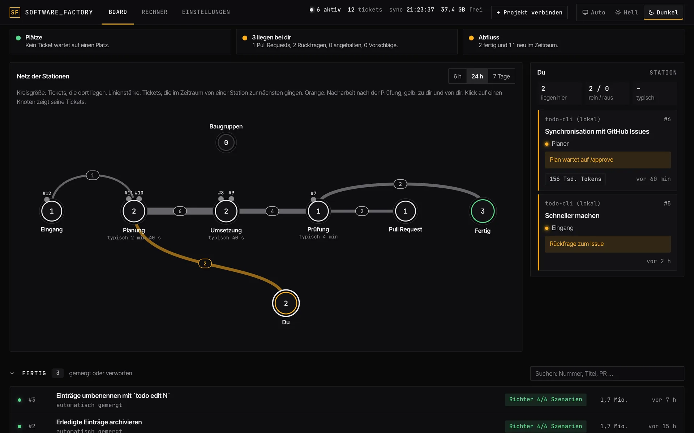
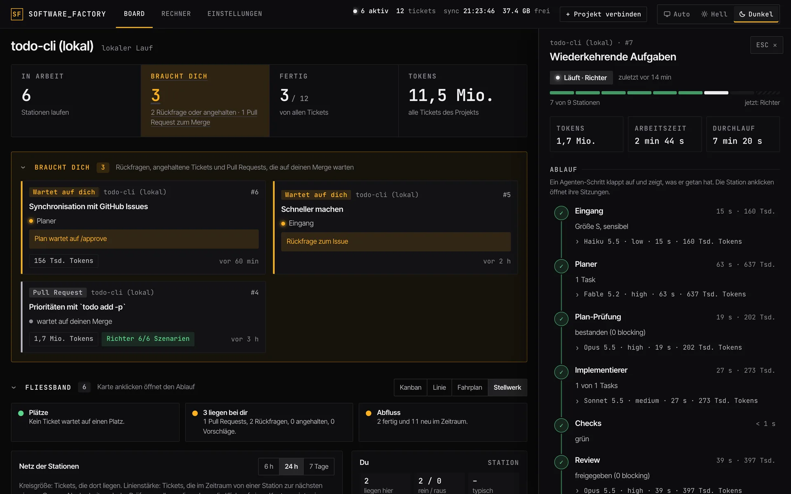
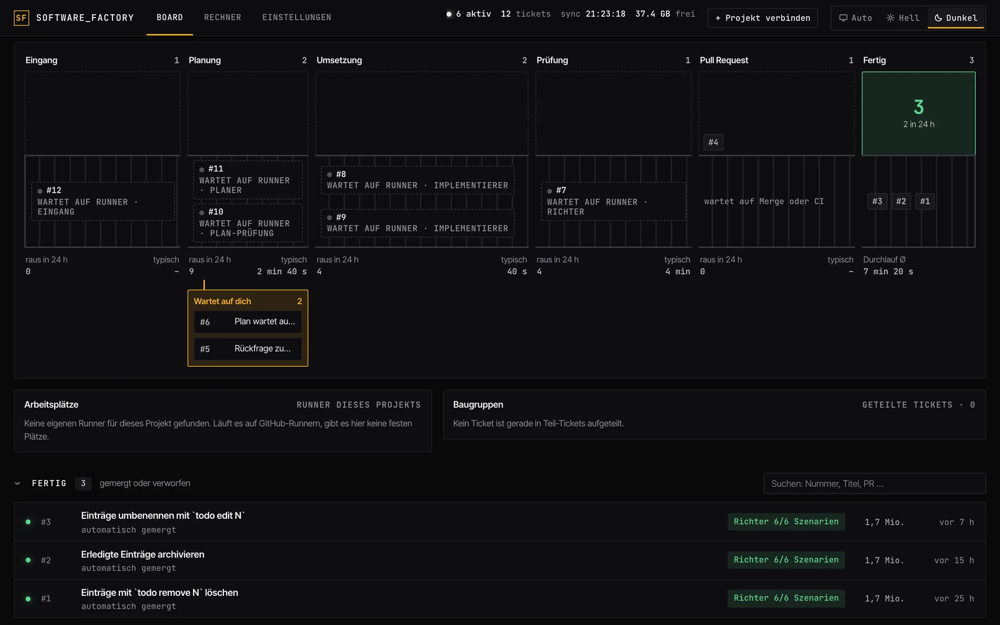

# Software Factory

[](https://github.com/HanSur94/software-factory/actions/workflows/selftest.yml)
[](LICENSE)


Ein GitHub-Issue mit dem Label `factory:go` wird hier zu einem geprüften Pull Request: Agents planen, schreiben und prüfen den Code, ein getrennter Richter prüft das Ergebnis gegen Szenarien, die der Implementierer nie gesehen hat. Im Dark-Modus wird der Pull Request danach ohne Menschen gemergt; sonst mergst du von Hand.

<p align="center">
  <a href="https://hansur94.github.io/software-factory/"></a>
</p>

<p align="center"><b><a href="https://hansur94.github.io/software-factory/">Projektseite</a></b> · <a href="#schnellstart">Schnellstart</a> · <a href="#board">Board</a> · <a href="CONTRIBUTING.md">Mitmachen</a></p>

> **In English:** Software Factory turns a GitHub issue labelled `factory:go` into a reviewed pull request. Claude agents plan, implement and review the change in fixed stations, driven by a plain Python script rather than by an agent. A separate judge then tests the result against hidden scenarios the implementer never saw. A local board shows every ticket on a production line. It runs on GitHub Actions (hosted or self-hosted runners) or locally. The documentation below is in German.

## Schnellstart

Du brauchst:

- Python 3.12 und `pip install -r requirements.txt`
- die [GitHub CLI](https://cli.github.com/) `gh`, angemeldet mit `gh auth login`
- [Claude Code](https://claude.com/claude-code) und einem Claude-Abo; auf GitHub als Secret `CLAUDE_CODE_OAUTH_TOKEN` aus `claude setup-token`

```bash
git clone https://github.com/HanSur94/software-factory.git
cd software-factory
pip install -r requirements.txt
python3 -m factory board          # Board und Einstellungen unter http://127.0.0.1:8787
```

Im Board „+ Projekt verbinden“ wählen (siehe [Ein Projekt anbinden](#ein-projekt-anbinden)), dann an einem Issue das Label `factory:go` setzen. Ohne GitHub geht es auch: [Lokal laufen lassen](#lokal-laufen-lassen).

## Ablauf eines Tickets

| Station | Wer | Liest | Schreibt |
|---|---|---|---|
| Eingang | Haiku 5.5 | Issue | `ticket.json` mit festem Auftrag, oder eine Rückfrage im Issue |
| Planer | Fable 5.2 | Ticket, Repo | `plan.md`: Tasks mit Abnahmekriterien |
| Plan-Prüfung | Opus 5.5 | Ticket, Plan | `plan-review.json` |
| Implementierer | Sonnet 5.5 | einen Task | Code und Tests; unabhängige Tasks gleichzeitig, jeder im eigenen Ordner |
| Checks | Kommandos des Projekts | den Branch | Ergebnis; bei Fehlern fasst Haiku 5.5 die Logs zusammen |
| Reviewer | Opus 5.5 | Diff, Ticket, Plan | `review.md` |
| Richter | Opus 5.5 | gebauten Stand, Szenarien-Repo | `verdict.json`: Wert und Fehlerbild, nie der Szenario-Text |
| Auslieferung | Skript | Verdict | Pull Request und im Dark-Modus der Merge, oder die nächste Runde |

Jede Station startet mit frischem Kontext und sieht nur die Dateien ihrer Vorgänger. Gesteuert wird von einem normalen Skript (`factory/pipeline.py`), nicht von einem Agent: Es führt die Stationen in fester Reihenfolge aus, zählt Runden und Budget und hält an einem Limit an.

### Parallele Arbeiter

Tasks eines Plans, die nicht voneinander abhängen und verschiedene Dateien anfassen, laufen gleichzeitig. Jeder Arbeiter bekommt dafür einen eigenen Ordner: einen Git-Worktree `wt-<ticket>-<task>` auf einem eigenen Branch, der vom Stand des Ticket-Branches startet. Die Arbeiter sehen einander nicht.

Was zusammen laufen darf, entscheidet das Steuerskript und kein Agent. Es liest dazu `depends_on` und `files` der Tasks im Plan:

- Ein Task startet erst, wenn alles fertig ist, wovon er abhängt.
- Zwei Tasks, die dieselbe Datei oder denselben Ordner nennen, laufen nicht in derselben Welle.
- Ein Task ohne `files` läuft allein.
- Mehr als `pipeline.parallel_tasks` Arbeiter (Standard 3) laufen nie gleichzeitig; mit 1 läuft alles nacheinander.

Sind die Arbeiter einer Welle fertig, setzt das Skript ihre Commits nacheinander auf den Ticket-Branch und löscht die Ordner. Passt ein Commit nicht auf die anderen, wird er verworfen und sein Task läuft noch einmal im Ordner des Tickets, wo er sieht, was die anderen gebaut haben. Checks, Review und Richter prüfen wie bisher den zusammengeführten Stand. Das Restbudget des Tickets wird unter den Arbeitern einer Welle aufgeteilt. Fällt ein Arbeiter aus, hält das Ticket an; was die anderen fertig haben, bleibt erhalten.

Parallele Arbeiter verkürzen den Durchlauf. Kosten sparen sie nicht, und das Abo-Kontingent verbrauchen sie schneller.

Auf GitHub sind das vier Jobs mit unterschiedlichen Rechten (`.github/workflows/run-ticket.yml`):

- `route` liest das Projektprofil und wählt die Runner
- `work` läuft von Eingang bis Review und pusht den Ticket-Branch
- `judge` ist der einzige Job, der das Szenarien-Repo sieht; nur `verdict.json` verlässt ihn
- `deliver` öffnet den Pull Request oder startet die nächste Runde

## Aufbau

```
factory.yaml          alles Wählbare: Modelle, Reihenfolge, Schwellen, Limits, Runner
contracts/            Schemas der Vertragsdateien, je mit Versionsnummer
stations/             ein Prompt je Station
factory/              das Steuerskript
  pipeline.py           Reihenfolge, Schleifen, Budget, Parken
  stations.py           Station ausführen, Vertragsdatei prüfen
  agent.py              der ausführende Agent: Umgebung, Zeitlimit, Mitschnitt, Ergebnis
  harness/              je Agent-CLI ein Adapter (heute claude.py für Claude Code)
  hosts.py              Ticketsystem und Code-Host: GitHub oder lokale Dateien
  state.py              Zustand: Branch im Produkt-Repo oder lokaler Ordner
  judge.py, deliver.py  Richter und Auslieferung
  report.py             Kennzahlen aus dem Ereignisprotokoll
  board.py, board.html  Kanban-Board im Browser
  theme.css, theme.js   gemeinsames Aussehen von Board und Einstellungsseite, hell/dunkel/auto
action.yml            bringt den Code dieses Repos in die Jobs der Produkt-Repos
templates/product/    was ein Produkt-Repo braucht: Workflow, Profil, Issue-Vorlage
plugin/               interaktive Station: Skill factory-handoff
tests/                Vertragstests und der ganze Ablauf als Trockenlauf
```

Teilsysteme sprechen nur über Vertragsdateien miteinander. Ein Teil wird ausgetauscht, indem man seine Datei ersetzt und die Tests laufen lässt.

## Konfiguration

Drei Schichten bestimmen, wie die Factory arbeitet; jede überschreibt die davor:

1. `factory.yaml`: die dokumentierten Standardwerte
2. `settings.yaml`: was du für alle Projekte geändert hast, geschrieben von der Einstellungsseite
3. Abschnitt `overrides` im Profil eines Projekts: was nur dort anders ist

Das Ergebnis wird vor jedem Lauf gegen `contracts/config.schema.json` geprüft. Ein falscher Wert hält den Lauf mit einer Meldung an, die den Schlüssel nennt.

### Einstellungsseite

```bash
python3 -m factory board
```

Danach `http://127.0.0.1:8787/settings` öffnen (oder im Board oben rechts auf „Einstellungen“ klicken). Oben wählst du, wofür die Werte gelten:

- **Alle Projekte:** Speichern schreibt `settings.yaml`, und zwar nur, was von `factory.yaml` abweicht. Lokale Läufe nutzen die Werte sofort. Die Läufe auf GitHub lesen die Factory von `main`, deshalb committet und pusht „Speichern und veröffentlichen“ die Datei gleich mit. Was nur deinen Rechner betrifft, also die Projekte des Boards (`board.repos`, `board.local`) und die Maschinenüberwachung (`machine`), landet in `settings.local.yaml`. Git ignoriert diese Datei, damit deine Projektliste nicht mit der Factory veröffentlicht wird.
- **Ein Projekt:** Speichern schreibt den Abschnitt `overrides` in `.factory/profile.yaml` als Commit auf den Standard-Branch des Projekts. Leere Felder übernehmen den Wert für alle Projekte. Die Seite zeigt dort auch die Checks des Projekts und ob die beiden Zugänge (Secrets) gesetzt sind; eintragen musst du sie selbst.

Einstellbar sind der Ablauf (beratend, blockierend oder aus je Station, Zahl der Runden), die Auslieferung samt Regeln für das automatische Mergen, Schwellen und Budgets, je Station Modell, Effort, Budget, Zeitlimit, Ersatzmodell und Skills, die Runner, die Skill-Packs und das Board. Der Schalter **Dark-Modus** setzt die vier Werte auf einmal. Für alles ohne eigenes Feld gibt es unter „Erweitert“ `settings.yaml` als Text.

Die Seite ist die einzige Stelle des Boards, die schreibt. Sie nimmt nur Anfragen an, die von ihr selbst auf diesem Rechner kommen.

### Von Hand

Dieselben Werte lassen sich in den Dateien ändern. Die häufigsten Handgriffe:

- **Modell einer Rolle ändern:** die Zeile `model` unter `roles.<rolle>`.
- **Station scharf schalten:** `pipeline.modes`. `advisory` berichtet nur, `gate` blockiert und schickt zurück, `off` überspringt. Am Anfang sind Plan-Prüfung, Review und Richter beratend; `python3 -m factory report` zeigt, ab wann eine Station oft genug mit deinem Urteil übereinstimmt.
- **Runner tauschen:** `runtime.capabilities` sagt, wo eine Fähigkeit läuft. Ein Projekt nennt in seinem Profil nur die Fähigkeit (`runtime: { work: unity }`).
- **Für ein Projekt abweichen:** Abschnitt `overrides` im Profil des Projekts.
- **Agent-CLI wählen:** `agent.harness` für alle Stationen, `roles.<rolle>.harness` für eine einzelne (auch auf der Einstellungsseite, je Station). Heute gibt es nur `claude` (Claude Code).

Budget, Satisfaction-Schwelle und die Regel für das Scharfschalten sind Beispielwerte.

### Harnesses

Eine Station braucht vom Agent nur: Prompt in einem Ordner ausführen, Ergebnis und Kosten melden. Was ein CLI dafür aufruft und ausgibt, steht in einem Adapter unter `factory/harness/`. Ein Adapter baut den Aufruf (`argv`), liest die Ausgabe Zeile für Zeile in neutrale Ereignisse (`text`, `tool`, `result`) und sagt in `capabilities`, was das CLI selbst kann: Budget-Grenze, Ersatzmodell, Effort, Befehls-Freigaben, Plugins, Skill-Tool, Kostenangabe. Zeitlimit, bereinigte Umgebung, Sitzungsprotokoll und Verträge bleiben in `agent.py` und gelten für jeden Adapter gleich.

Auf GitHub installiert jeder Job die CLIs der Harnesses, in denen seine Stationen laufen; der Richter-Job nur das des Richters. Die Version setzt `agent.versions.<harness>`, für den Standard-Harness auch `agent.version`, sonst `latest`.

Ein Harness ohne Befehls-Freigaben läuft nur auf einem Sandbox-Runner (`FACTORY_SANDBOXED=1`); sonst hält die Station mit einer Meldung an. Welche Secrets ein Projekt braucht, ergibt sich aus den Harnesses, in denen seine Stationen laufen.

Ein neuer Harness ist ein Modul neben `claude.py` und eine Zeile in `factory/harness/__init__.py`.

## Dark-Modus

Ein Projekt wird dark, indem sein Profil die Prüfstationen zu Toren macht und den Auto-Merge einschaltet:

```yaml
overrides:
  pipeline:
    modes: { plan_check: gate, review: gate, judge: gate }
  delivery:
    auto_merge: true
```

Gemergt wird dann ohne Menschen, aber nur, wenn alle Regeln erfüllt sind (`delivery.auto_merge_rules` in `factory.yaml`):

- die Checks sind grün, das Review hat freigegeben, der Richter hat bestanden
- der Richter hatte mindestens 3 Szenarien
- die Änderung umfasst höchstens 200 Zeilen
- das Ticket ist nicht als sensibel markiert
- die Änderung hat keine geschützten Pfade angefasst
- der Branch enthält den aktuellen Basis-Branch; hat sich dieser inzwischen bewegt, wird er eingearbeitet und die Checks laufen erneut

Ist eine Regel nicht erfüllt, bleibt der Pull Request offen, und der Kommentar am Issue nennt den Grund. Neue Projekte starten ohne Auto-Merge.

## Mehr Autonomie

Drei Schalter lassen die Factory mehr allein machen. Zusammen sieht das im Profil so aus:

```yaml
overrides:
  pipeline:
    questions: assume
  limits:
    max_parallel_tickets: 8
    daily_budget_usd: 40
  delivery:
    auto_merge: true
    auto_merge_rules: { require_judge: false, allow_assumptions: true }
```

- **Annahmen statt Rückfragen** (`pipeline.questions: assume`): Intake und Planer entscheiden offene Punkte selbst, nehmen die Lesart, die sich später am leichtesten ändern lässt, und schreiben jede Annahme in einen Kommentar am Issue und in den Pull Request („Annahmen, bitte prüfen“). Angehalten wird nur noch für das, was nur du liefern kannst: ein Programm oder Gerät außerhalb des Repos (etwa ein installiertes Spiel), einen Zugang, ein Geheimnis, oder eine Entscheidung, deren falsche Annahme teuer wäre. Große Pläne warten nicht mehr auf `/approve`.
- **Mergen ohne Richter-Szenarien** (`auto_merge_rules.require_judge: false`): Hat der Richter nichts zu prüfen, merged die Factory, sobald alle Checks auf dem Pull Request grün sind, das Review freigegeben hat und die übrigen Regeln erfüllt sind. Ein Richter, der ausdrücklich durchfällt, hält den Merge weiter auf. Tickets mit Annahmen bleiben beim Menschen, solange `allow_assumptions` nicht gesetzt ist.
- **Orchestrator** (`python3 -m factory orchestrate`, im Aufruf-Workflow nach Zeitplan): schaut nach allen Tickets des Projekts und
  - startet Tickets neu, deren Lauf abgebrochen ist (kein Lauf und seit `orchestrator.stale_minutes` kein Ereignis) oder die an einem Fehler der Maschinerie hängen geblieben sind, höchstens `orchestrator.max_auto_restarts` Mal; Stopps, die an der Arbeit liegen (Budget, Nacharbeitsrunden, Richter), bleiben für dich;
  - holt CI-Ergebnisse nach, die nie angekommen sind (rot: Nacharbeit, grün: Merge);
  - bringt ausgelieferte Pull Requests, die GitHub als Merge-Konflikt mit der Basis meldet, selbst wieder auf den Stand: der nächste Lauf arbeitet die Basis ein, der Implementierer löst den Konflikt (Phase `rework_base`), danach prüfen Checks, Review und Richter neu. Höchstens einmal pro Commit der Basis, nur bei freiem Platz und Tagesbudget; ein Konflikt, der bleibt, wartet auf dich;
  - gibt freie Plätze an wartende Tickets.

  Plätze und Geld begrenzen `limits.max_parallel_tickets` und `limits.daily_budget_usd` (Ausgaben aller Tickets eines UTC-Tages). Ein Ticket ohne Platz wartet mit dem Label `factory:queued`; jeder Lauf, der endet, startet das älteste wartende selbst, der Zeitplan ist nur das Netz darunter.

## Ein Projekt anbinden

Am einfachsten über die Web-Oberfläche: im Board oben rechts „+ Projekt verbinden" (oder `http://127.0.0.1:8787/settings#verbinden`).

1. Repo eintragen (Name als `owner/name` oder die Adresse von GitHub; deine eigenen Repos werden vorgeschlagen) und „Prüfen" klicken. Die Seite zeigt, was schon da ist und was fehlt, und schlägt aus den Dateien des Repos Setup und Checks vor.
2. Ziel-Branch, Runner und die Kommandos der Checks ansehen oder ändern, dann „Verbinden".
3. Die Seite legt die Labels an, erlaubt Actions, Pull Requests zu öffnen, öffnet einen Pull Request mit Profil, Workflow und Ticket-Vorlage und nimmt das Projekt ins Board auf. Arbeitet das Projekt nicht auf dem Standard-Branch, kommt ein zweiter Pull Request dazu, der nur den Workflow auf den Standard-Branch bringt.
4. Für dich bleibt: die Pull Requests mergen und den Zugang zu Claude als Secret eintragen. Die Seite zeigt das Kommando; den Token fasst sie nicht an.

Auf einen Branch, an dem gearbeitet wird, schreibt die Seite nie direkt. Ein verbundenes Projekt zeigt unter seinem Namen jederzeit denselben Stand („Stand neu prüfen"), und „aus dem Board nehmen" entfernt es wieder aus der Anzeige.

Dasselbe von Hand:

1. `setup/attach-project.sh OWNER/REPO` legt die Labels an und erlaubt Actions, Pull Requests zu öffnen.
2. Den Inhalt von `templates/product/` ins Repo kopieren und `.factory/profile.yaml` anpassen (Checks, Szenarien-Repo).
3. Einen Modell-Zugang als Secret setzen, eines von beiden:
   ```bash
   gh secret set ANTHROPIC_API_KEY --repo OWNER/REPO
   ```
   ```bash
   gh secret set CLAUDE_CODE_OAUTH_TOKEN --repo OWNER/REPO
   ```
   Der zweite Weg nutzt dein Claude-Abo; den Token erzeugt `claude setup-token`.
4. Für den Richter ein privates Szenarien-Repo anlegen und dessen Deploy-Key (nur lesend) als Secret `SCENARIOS_DEPLOY_KEY` im Produkt-Repo hinterlegen.

Für Projekte, die nicht auf dem Standard-Branch entwickeln oder einen eigenen Runner brauchen:

- **Ziel-Branch:** `base: develop` im Aufruf-Workflow (beide Stellen). Tickets starten dann von diesem Branch, Pull Requests zielen auf ihn, und das Profil wird von dort gelesen. Der Aufruf-Workflow selbst muss auf dem Standard-Branch liegen, weil GitHub Issue-Ereignisse nur dort auswertet.
- **Pflicht-Checks:** Öffnet die Factory einen Pull Request mit dem Job-Token, hält GitHub dessen Workflows oft zur Freigabe zurück (`action_required`). Nur diese Läufe melden sich am Pull Request; solange sie warten, bleibt er blockiert, auch wenn dieselben Checks anders gestartet grün sind. Die Factory gibt solche Läufe deshalb nach dem Öffnen selbst frei. Hält GitHub nichts zurück, gilt: Ein Pull Request der Factory startet keine Workflows des Projekts. Verlangt der Branch-Schutz Checks, nennt das Profil sie unter `overrides.delivery.trigger_workflows`; die Factory startet sie dann selbst auf dem Ticket-Branch. Die Workflows brauchen dafür den Auslöser `workflow_dispatch`.
- **CI als Tor, ohne dass Agents warten:** Braucht die CI eine Maschine, die es nur einmal gibt (ein Mac mit Unity-Lizenz), bleibt der Arbeits-Job auf GitHubs Runnern (`runtime: { work: linux }`), und im Ticket laufen nur die Checks, die diese Maschine nicht brauchen. Die schwere Suite läuft als CI auf dem Pull Request und wartet dort auf ihren Runner. Ihr Ergebnis kommt über einen letzten Job im CI-Workflow zurück, der `report-ci.yml` aufruft (Beispiel im Kopf der Datei): Die Factory startet die CI mit dem Job-Token, und für solche Läufe startet GitHub kein `workflow_run`; `workflow_dispatch` ist der eine Weg zurück. Für Läufe, die ein Mensch auslöst, hört der Aufruf-Workflow zusätzlich mit `workflow_run` auf diese Workflows (ihre `name:`, nur auf `factory/**`-Branches). Ist die CI rot, geht das Ticket mit dem Log der fehlgeschlagenen Schritte zur Nacharbeit zurück (`rework_ci`) und läuft danach wieder bis zum Pull Request; nach `pipeline.max_ci_rounds` roten Runden hält es an. Die Einstellungsseite trägt den Auslöser beim Verbinden ein, wenn Pflicht-Checks angegeben sind.
- **Langsam gebaute Ordner:** `warm_dirs: [Library]` im Profil nennt Ordner, die git ignoriert und die die Werkzeuge des Projekts nur langsam neu bauen (Unitys `Library/`). Jeder Ticket-Ordner und jeder parallele Arbeiter startet mit einer Kopie aus dem Checkout des Runners, auf APFS als Klon ohne zusätzlichen Platz. Nach grünen Checks übernimmt der Runner den neueren Stand, damit das nächste Ticket warm startet.
- **Eigener Runner:** `runtime: { work: unity }` im Profil schickt den Arbeits-Job auf den Runner der Fähigkeit. Die kleinen Steuer-Jobs (route, deliver, CI-Rückmeldung, Orchestrator, Ergebnis) laufen auf GitHubs Runnern, außer der Aufruf-Workflow gibt jedem `uses:`-Job `runner: '["factory-mac"]'` mit; dann läuft die ganze Factory auf eigenen Maschinen. Auf eigenen Runnern räumt der Checkout ignorierte Ordner nicht weg. Dort läuft der Agent ohne Sandbox und darf nur die Programme aus `agent_commands` starten. Der Checkout lässt ignorierte Ordner wie Unitys `Library/` stehen.

Danach: Issue nach der Vorlage schreiben, Label `factory:go` setzen. Das Label zählt nur, wenn der Besitzer des Repos es setzt.

## Bedienen

| Du willst | So geht es |
|---|---|
| ein Ticket starten | Label `factory:go` am Issue |
| eine Rückfrage beantworten | im Issue antworten; das Ticket läuft weiter |
| einen großen Plan freigeben | mit `/approve` antworten, oder mit einem Änderungswunsch |
| ein angehaltenes Ticket neu starten | „Neu starten“ auf dem Board, oder `factory:go` erneut setzen; es macht an der Stelle weiter, mit frischem Budget. Ein Kommentar von dir davor geht als Hinweis an den Implementierer |
| ein Ticket, dessen Lauf abgebrochen ist, weiterlaufen lassen | „Erneut anstoßen“ im Ticket auf dem Board: startet den Workflow für das Issue neu, das Ticket macht in seiner Phase weiter. Ein Lauf, der noch arbeitet, wird nicht verdoppelt; der neue wartet dahinter |
| die Leitungen testen, ohne Tokens | Actions → factory → Run workflow, Haken bei „Trockenlauf“ |

Der Zustand eines Tickets liegt im Branch `factory-state` des Produkt-Repos unter `tickets/<nummer>/`: alle Vertragsdateien, `status.json` und `events.jsonl`.

## Board

Ein kleines Kanban-Board zeigt alle Tickets nach ihrem Stand: Eingang, Planung, Umsetzung, Prüfung, Wartet auf dich, Angehalten, Pull Request, Fertig.

```bash
python3 -m factory board
```

<table>
  <tr>
    <td width="50%"><br><sub><b>Stellwerk:</b> wo Tickets liegen und wie sie fließen</sub></td>
    <td width="50%"><br><sub><b>Ticket:</b> jeder Schritt mit Modell und Dauer</sub></td>
  </tr>
  <tr>
    <td width="50%"><br><sub><b>Fahrplan:</b> wohin die Zeit ging</sub></td>
    <td width="50%"><br><sub><b>Linie:</b> das Band von der Seite</sub></td>
  </tr>
</table>


Danach `http://127.0.0.1:8787` öffnen. Jedes Projekt hat sein eigenes Board unter `/p/OWNER/REPO` (lokale Läufe unter `/p/local/N`): oben was dich braucht, darunter das Fließband mit einer Bahn je Station, am Ende die fertigen Tickets. Die Startseite zeigt alle Projekte als Kacheln mit offenen Punkten, laufender Arbeit und Kosten; ist nur ein Projekt verbunden, öffnet sie direkt dessen Board. Über die Leiste oben wechselst du zwischen den Projekten. Das Board liest nur: den Branch `factory-state` der Repos unter `board.repos` in `settings.local.yaml` (über `gh`) und die lokalen Läufe unter `board.local`. Es aktualisiert sich alle 8 Sekunden; ein Ticket, an dem gerade gearbeitet wird, hat einen blauen Rand.

Angehaltene Tickets haben auf ihrer Karte den Knopf **Neu starten**, Tickets in Arbeit im geöffneten Ablauf den Knopf **Erneut anstoßen**. Beide starten den Workflow `factory.yml` des Projekts für dieses Issue, mit deinem `gh`-Zugang; wie die Einstellungsseite nimmt das Board solche Anfragen nur von sich selbst auf diesem Rechner an.

Ein Klick auf eine Karte öffnet den Ablauf des Tickets:

- **Stationen** der Reihe nach: welche fertig ist, welche gerade läuft, mit Dauer und Kosten je Station und je Lauf
- **Skills:** welche einer Station angeboten wurden und welche der Agent wirklich aufgerufen hat
- **Tools:** wie oft welches Tool lief (Bash, Read, Edit, …)
- **Ort:** wo die Station lief, etwa „GitHub-Runner, frische VM, kein Docker“
- **Aktivität:** jeder Tool-Aufruf der Agents mit Uhrzeit, während des Laufs alle paar Sekunden aktualisiert. Der Richter fehlt dort mit Absicht, denn was er tut, verrät die Szenarien.
- **Tokens und Kontextfenster:** je Lauf die genauen Tokens (Eingabe, Ausgabe, aus dem Cache gelesen, in den Cache geschrieben) und wie voll das Kontextfenster höchstens war
- darunter Auftrag, Plan, Funde des Reviews, Fehlerbilder des Richters und der Verlauf der Ereignisse

Ein Klick auf eine **Station** im Ablauf öffnet daneben ihre Sitzungen: den Auftrag an die Station, was der Agent gesagt hat, jeden Tool-Aufruf mit Eingabe und Ergebnis, die Antwort am Ende und die Dateien, die die Station geschrieben hat. Zugangsdaten werden vor dem Schreiben entfernt. Die Sitzung des Richters bleibt in seinem Job.

Oben im Board steht der Stand deines **Claude-Abos**: wie viel Prozent des Kontingents verbraucht sind und wann es sich zurücksetzt. Die Claude-CLI meldet diesen Wert bei jedem Lauf; er gilt für das ganze Abo, nicht nur für die Factory. Je Ticket zeigt das Board, um wie viele Prozentpunkte der Wert während des Tickets gestiegen ist.

Unter dem Board steht eine Tabelle über alle Tickets: Dauer und Kosten je Station, Arbeitszeit, Durchlaufzeit, Gesamtkosten, Tokens, Abo-Verbrauch und benutzte Skills.

Die Factory liest dafür jeden Agent-Lauf Zeile für Zeile mit und veröffentlicht ihren Stand vor jeder Station und währenddessen etwa alle 15 Sekunden.

## Lokal laufen lassen

Derselbe Ablauf ohne GitHub, mit dem Claude-Login dieses Rechners:

```bash
python3 -m factory local --repo ../mein-projekt --issue 1 --issue-file ticket.md --scenarios ../mein-projekt-scenarios --budget 5
```

Das Issue ist eine Markdown-Datei (erste Zeile ist der Titel). Gearbeitet wird in einem eigenen Worktree unter `~/.cache/software-factory/<projekt>/`; der Arbeitsstand im Projektordner bleibt unberührt. Lokal gibt es keine Sandbox: Der Implementierer darf nur die Programme starten, die das Profil unter `agent_commands` nennt.

Tests der Factory selbst, ohne Modellaufrufe:

```bash
python3 -m pytest -q
```

## Sicherheit

- Agents und Checks bekommen eine bereinigte Umgebung ohne GitHub-Token. Git-Operationen übers Netz macht nur das Steuerskript.
- Änderungen an `.github/` und `.factory/` werden vor jedem Commit verworfen. Das Profil wird immer vom Basis-Branch gelesen.
- Stationen, die nur lesen sollen, können den Arbeitsstand nicht verändern: Was sie ändern, wird zurückgesetzt.
- Der Richter gibt nur Wert und Fehlerbild heraus. Ein Fehlerbild, das Text aus einem Szenario enthält, wird zurückgehalten.
- Jedes Ticket hat ein Budget; ist es aufgebraucht, hält das Ticket an.
- Docker wird nicht benutzt. Auf GitHub läuft jeder Job in einer frischen virtuellen Maschine, die danach verworfen wird; lokal läuft die Factory ohne Sandbox in einem eigenen Worktree.

## Stand

Umgesetzt sind unbeaufsichtigte Läufe mit Holdout-Richter und der Dark-Modus mit Auto-Merge. Er ist je Projekt einzuschalten und läuft in einem Testprojekt.

Noch offen gegenüber der Spezifikation:

- Parallele Arbeiter eines Tickets laufen auf demselben Runner im selben Job, nicht auf mehreren Maschinen. Mehrere Tickets laufen nebeneinander, jedes in einem eigenen Lauf.
- Der Runner wird je Job gewählt (Arbeit, Richter), nicht je Station.
- Die Plan-Prüfung nutzt einen eigenen Prompt nach dem Muster frischer Prüfer. Der Skill `egm-review-loop` ist vorbereitet (`roles.plan_check.entry`), aber unbeaufsichtigt noch nicht erprobt.
- Kein Merge-Queue und kein Rollback. Statt der Queue arbeitet die Auslieferung den Basis-Branch vor dem Merge ein und prüft erneut; der Richter läuft danach nicht noch einmal.
- Ein automatischer Merge durch den Job-Token löst keine weiteren Workflows aus und wird nicht als menschliches Urteil gezählt.
- Der Richter spielt Szenarien über die Kommandozeile durch. Für Spiele (Messwerte, zerlegte Screenshots) fehlt die Umsetzung.
- Pull Requests, die der Job-Token öffnet, lösen keine anderen Workflows aus. Ein Projekt mit Pflicht-Checks auf Pull Requests braucht dafür einen eigenen Token.

## Lizenz

MIT, siehe [LICENSE](LICENSE). Freie Software: benutzen, ändern und weitergeben ist ausdrücklich erlaubt.
